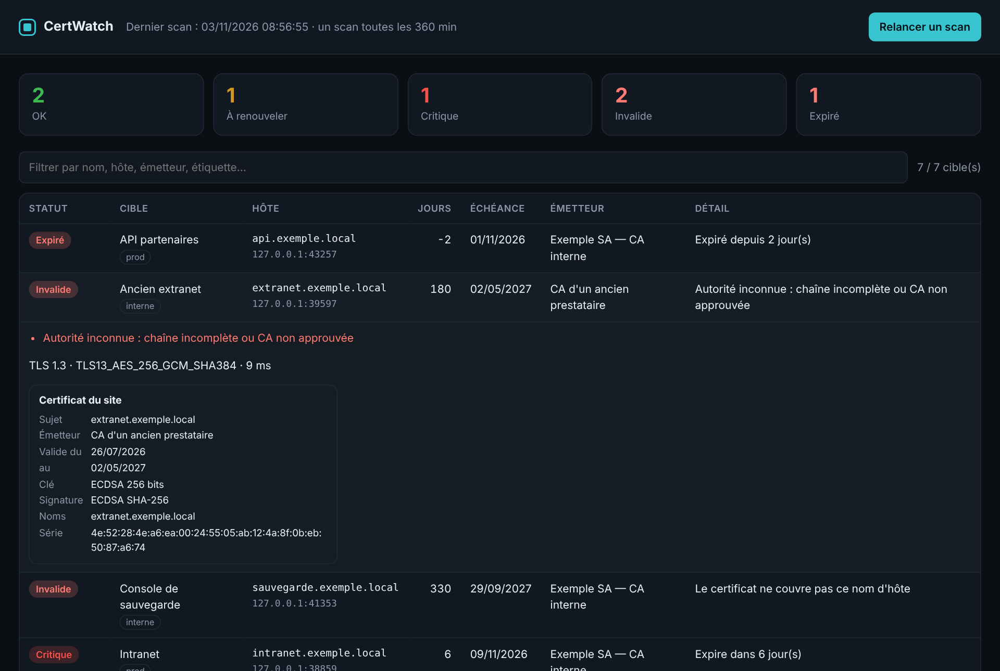

# CertWatch

**Surveillance des certificats TLS pour les équipes d'exploitation.** CertWatch vérifie des dizaines ou des centaines de services (sites web, LDAPS, messagerie, consoles internes), repère les certificats qui vont expirer, mais aussi ceux qui sont *mal déployés* : chaîne incomplète, CA inconnue, nom qui ne correspond pas, clé trop courte. Il prévient l'équipe sur Teams, Slack ou n'importe quel webhook, et seulement quand quelque chose change.

Un seul exécutable, écrit en Rust, sans dépendance système.



## Pourquoi

Un certificat expiré, c'est un site public qui affiche une alerte de sécurité, une API partenaire qui tombe ou une messagerie qui refuse les connexions, souvent un vendredi soir. Les outils de supervision généralistes savent lire une date d'expiration, mais rarement :

- dire **pourquoi** une chaîne est refusée, tout en lisant quand même le certificat déployé ;
- voir qu'un **certificat intermédiaire** expire avant celui du site ;
- vérifier des services **internes** signés par la PKI de l'entreprise, ou joints **derrière un proxy** ;
- contrôler la messagerie en **STARTTLS** (SMTP, IMAP, POP3) ;
- prévenir **une seule fois** par changement, avec un rappel, sans spammer le canal de l'équipe.

CertWatch fait tout cela.

## Fonctions

| | |
|---|---|
| **Contrôles** | Échéance (au maillon de la chaîne qui expire en premier), validation complète de la chaîne et du nom, certificat pas encore valide, clé RSA < 2048 bits, signature SHA-1, version TLS et suite négociées |
| **Statuts** | `ok`, `warning`, `critical` (seuils réglables, globaux ou par cible), `invalid`, `expired`, `error` (injoignable, délai dépassé, DNS) |
| **Cibles** | `hôte`, `hôte:port`, IPv6, URL, SNI différent de l'adresse, STARTTLS `smtp` / `imap` / `pop3`, liste en fichier texte avec étiquettes |
| **Entreprise** | CA internes approuvées (`ca_files`), proxy HTTP CONNECT avec authentification et `no_proxy`, vérifications en parallèle (`concurrency`) |
| **Alertes** | Microsoft Teams (carte adaptative), Slack, webhook JSON générique ; uniquement aux changements de statut et au retour à la normale, rappel toutes les N heures, filtrage par étiquette |
| **Service** | Tableau de bord web, API JSON, métriques Prometheus, scan manuel protégé par jeton, en-têtes de sécurité (CSP stricte) |
| **Sorties** | Tableau en couleurs, JSON, CSV ; codes de sortie 0 / 1 / 2 pour cron, Zabbix, Nagios ou Centreon |

## Essayer en 30 secondes

```bash
git clone https://github.com/SunoriOff/certwatch && cd certwatch
cargo run --example demo
```

La démo lance sept faux services TLS sur `127.0.0.1` (un par cas de figure, avec une CA générée à la volée) et ouvre le tableau de bord sur <http://127.0.0.1:8088/>. Aucun accès réseau n'est nécessaire.

## Installation

```bash
cargo install --path .           # ou télécharger un binaire depuis les « Releases »
certwatch init > certwatch.toml  # exemple de configuration commenté
```

## Utilisation

```bash
# Contrôle ponctuel, sans fichier de configuration
certwatch check --host www.exemple.fr --host ldap.exemple.local:636

# Toutes les cibles de la configuration ; seulement ce qui demande une action
certwatch -c certwatch.toml check --only-problems

# Depuis cron ou une tâche planifiée : contrôle + alertes
certwatch -c certwatch.toml check --alert --format json > dernier-scan.json

# Détail d'une chaîne (sujet, émetteur, SAN, clé, série…)
certwatch inspect smtp.exemple.fr:587 --starttls smtp

# Service : scans périodiques, tableau de bord, API et métriques
certwatch -c certwatch.toml serve
```

Exemple de sortie :

```text
STATUT        CIBLE              HÔTE                      JOURS  ÉCHÉANCE    DÉTAIL
Expiré        API partenaires    api.exemple.fr:443        -2     01/11/2026  Expiré depuis 2 jour(s)
Invalide      Ancien extranet    extranet.exemple.fr:443   180    02/05/2027  Autorité inconnue : chaîne incomplète ou CA non approuvée
Critique      Intranet           intranet.exemple.fr:443   6      09/11/2026  Expire dans 6 jour(s)
À renouveler  Messagerie web     mail.exemple.fr:443       24     27/11/2026  Expire dans 24 jour(s)
OK            Portail RH         rh.exemple.fr:443         240    01/07/2027  Expire dans 240 jour(s)

5 cible(s) · 1 ok · 1 à renouveler · 1 critique · 1 invalide · 1 expiré
```

### Codes de sortie

| Code | Signification |
|---|---|
| 0 | Tout est en règle |
| 1 | Au moins un avertissement |
| 2 | Au moins un problème critique, invalide, expiré ou injoignable |
| 3 | Erreur d'utilisation (configuration illisible…) |

## Configuration

Voir [`examples/certwatch.toml`](examples/certwatch.toml), entièrement commenté. L'essentiel :

```toml
[settings]
warning_days = 30
critical_days = 14
ca_files = ["ca-interne.pem"]            # PKI de l'entreprise
proxy = "http://proxy.exemple.local:3128"
no_proxy = [".exemple.local"]
targets_file = "cibles.txt"              # une cible par ligne, étiquettes facultatives

[[alert]]
kind = "teams"
url = "https://…"                        # flux « Workflows » de Teams
min_status = "warning"
tags = ["prod"]

[[target]]
host = "10.0.0.20"
port = 8443
sni = "console.exemple.local"
name = "Console hyperviseur"
warning_days = 45
```

Les chemins relatifs sont résolus par rapport au fichier de configuration. Un champ mal orthographié est refusé au démarrage plutôt qu'ignoré en silence.

## Intégrations

**Prometheus** : `GET /metrics` expose `certwatch_days_remaining`, `certwatch_status`, `certwatch_targets` et `certwatch_last_scan_timestamp_seconds`. Exemple de règle :

```yaml
- alert: CertificatBientotExpire
  expr: certwatch_days_remaining < 14
```

**Zabbix** (élément de type agent) :

```ini
UserParameter=certwatch.days[*],certwatch check --host "$1" --format json | jq '.[0].days_remaining'
UserParameter=certwatch.status[*],certwatch check --host "$1" >/dev/null; echo $?
```

**API** : `GET /api/status` renvoie l'état complet en JSON ; `POST /api/scan` (en-tête `Authorization: Bearer <api_token>`) relance un scan.

## Déploiement

- **systemd** : [`deploy/certwatch.service`](deploy/certwatch.service), avec utilisateur dynamique et durcissement (`ProtectSystem=strict`, filtrage des appels système…).
- **Docker** : [`Dockerfile`](Dockerfile) multi-étapes vers une image *distroless* non-root, et [`deploy/docker-compose.yml`](deploy/docker-compose.yml) en lecture seule, sans capacités.
- **Windows** : le binaire fonctionne tel quel ; `check --alert` se planifie avec le Planificateur de tâches.

Le tableau de bord n'a pas d'authentification propre. Il écoute par défaut sur `127.0.0.1` : publiez-le derrière un reverse proxy authentifié, ou sur un réseau d'administration.

## Comment ça marche

```text
cibles ──► scan parallèle ──► connexion TCP (directe ou tunnel CONNECT)
                                 └─► STARTTLS éventuel ─► poignée de main TLS
                                         └─► vérificateur « enregistreur »
                                               ├─ garde la chaîne présentée
                                               └─ garde le verdict webpki
        ◄── analyse (x509) ◄── classement ◄── seuils
résultats ──► tableau / JSON / CSV
          └─► état précédent ──► alertes aux changements ──► Teams / Slack / webhook
```

Le point clé est le **vérificateur enregistreur**. Un client TLS classique abandonne dès que la chaîne est refusée : on sait que « ça ne marche pas », mais pas ce qui est déployé. CertWatch laisse la poignée de main aller à son terme. Il conserve d'un côté la chaîne réellement envoyée par le serveur, et de l'autre le verdict du vérificateur standard (`webpki`). Le rapport peut ainsi dire « autorité inconnue, mais le certificat expire dans 180 jours, émis par telle CA ». Aucune donnée applicative n'est échangée : la connexion est fermée juste après la poignée de main.

Choix techniques : `tokio` pour l'asynchrone, `rustls` avec le fournisseur `ring` (aucune dépendance à OpenSSL), `x509-parser`, `axum` pour le service web, état des alertes écrit de façon atomique (fichier temporaire puis renommage).

## Limites connues

- `rustls` ne parle que TLS 1.2 et 1.3 : un serveur limité à TLS 1.0 ou 1.1 apparaît comme « injoignable », avec le motif de l'échec de négociation.
- La révocation (OCSP, CRL) n'est pas vérifiée.
- STARTTLS est géré pour SMTP, IMAP et POP3, pas pour LDAP (389) ni pour les bases de données.

## Développement

```bash
cargo test     # 36 tests, dont 10 de bout en bout sur de vrais serveurs TLS locaux
cargo clippy --all-targets -- -D warnings
```

Les tests d'intégration fabriquent une CA et des certificats pour chaque cas : CA interne, CA inconnue, mauvais nom, expiré, pas encore valide, port fermé, délai dépassé, proxy CONNECT authentifié, STARTTLS SMTP, ainsi que l'API et les métriques du service.

## Licence

MIT — Joris Pelaud
